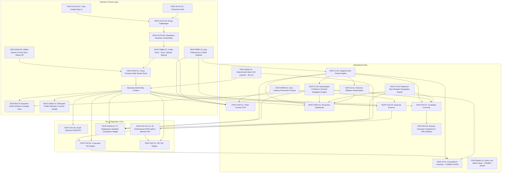

# Mizan (ميزان) - Feature Dependency Graph & Architecture Log

> **UI Overhaul Status (2026-11-14):** Mobile UI screens and visual components were reset to a clean shell for screen-by-screen rebuild (archived on `archive/pre-ui-overhaul`). Backend modules remain intact.

### Dependency Audit
- **Entry Security**: Users entering the mobile application must pass `AUTH` and verify identity.
- **Entity Pre-condition**: `DASH`, `TAX_ENG`, and `INVOICE` require `activeBusiness` with a valid `tradeLicenseNumber` and jurisdiction configuration.
- **Onboarding Gate**: If `businesses.length == 0`, the navigation stack intercepts routing and locks into `ONBOARD` until valid company details are committed.
- **Adaptive Theming**: `THEME` resolves OS `useColorScheme()` against the persisted `themeMode` preference (`'system' | 'light' | 'dark'`) via `ThemeProvider` and `expo-system-ui`, while intentionally keeping camera scanner viewfinders dark and exported `expo-print` HTML reports white-paper.
