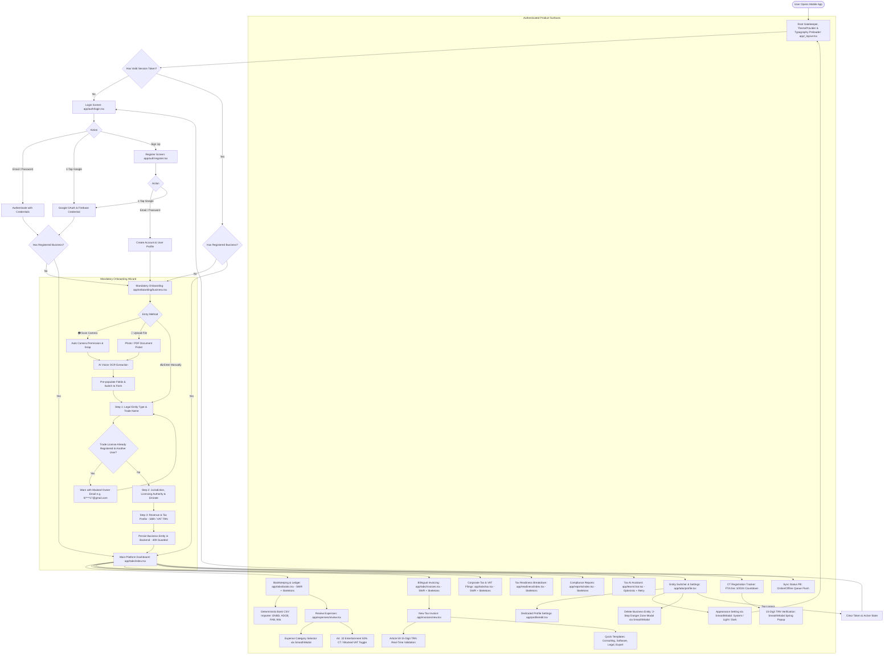

# Mizan (ميزان) - User Journeys & State Transitions

> **UI Overhaul Status (2026-11-14):** Mobile UI screens are currently reset to the Clean UI Rebuild Shell (`mobile/app/index.tsx`). The diagram below represents the target/archived journey (archived on `archive/pre-ui-overhaul`) to be rebuilt screen by screen.

